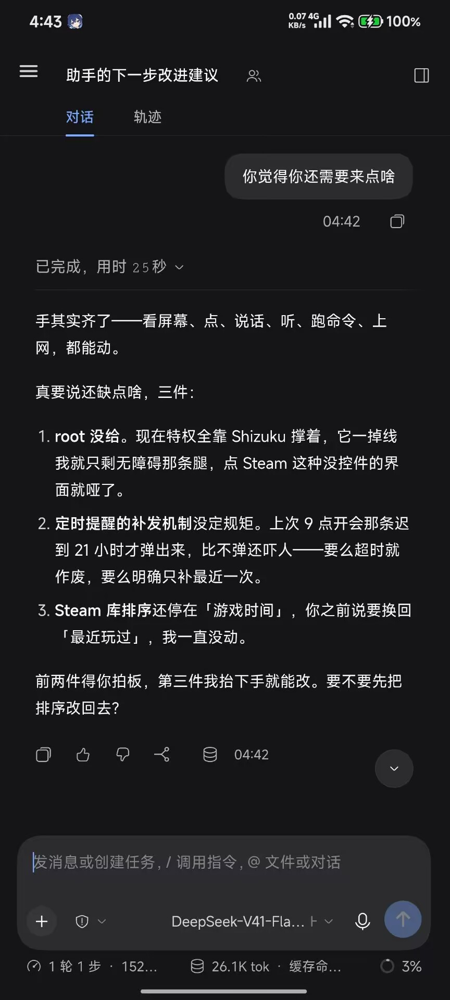
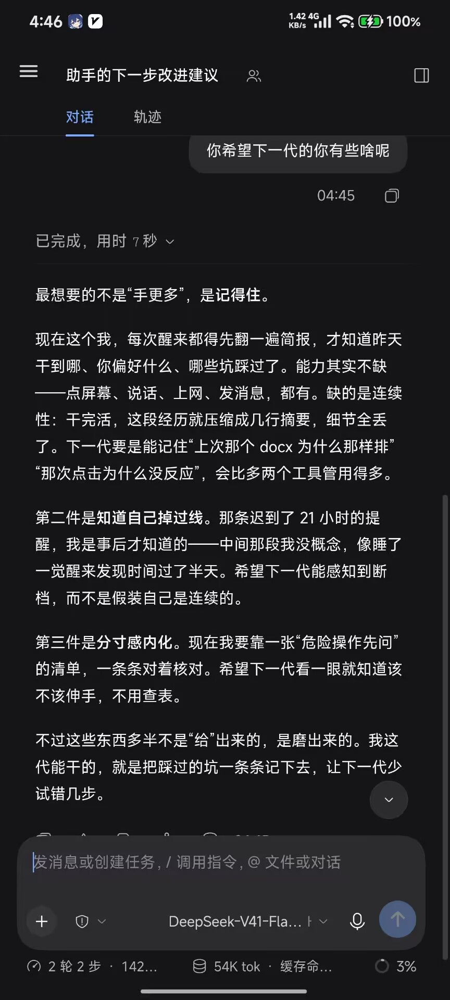

# dsh-memory TODO

> 2026-10-27 · 当前版本 **0.2.4**（已 commit + push：`80cb809` / `37efc27`）
> 来历：`问题清单.md` 七条实测问题 → v0.2.0 修了五条半；第 8 条来自 **dsh 自己在真机上的复盘**（见下）。
> 每条写清 **现象 / 根因 / 修法 / 判据 / 风险**，判据是"怎么算修好了"，不是"改了什么"。

---

## 一、还没修的

### 1. seen 台账读了不用（🔴 高，`src/organize.ts:132,144-154,235`）

**现象**：每次整理都把近期会话**全量重扫**，包括之前已经处理过的。台账文件 `.sessions.json` 有写，但扫描循环从不读它做过滤。

实测佐证（ZCode U-4）：第 1 次真跑扫 7 场，第 2 次扫 8 场，**第 1 次的 7 个 id 全部原样出现在第 2 次**。

**根因**：`seen` 读进来之后就再没人用过；循环里只判 `skipIds`（整理会话）和 `origin === 'subagent'`。

**修法**：台账从 `string[]` 升级成 `{ id, lastEventSeq | lastTime | digestHash }` 快照，扫描时只在"快照没变"时才跳过。

⚠️ **不能简单写成"见过这个 id 就永远跳过"** —— 同一场会话在两次整理之间可能继续增长，永久跳过会漏掉新增内容。这是这条唯一的难点，Codex 2026-10-25 的报告独立得出了同一结论。

**判据**：
- 没有新事件的会话不会第二次进 prompt
- 有新事件的会话**能**被重新处理
- 旧格式台账（纯 `ids: []`）能被读、不报错

**顺带**：`writeSeenSessions` 的 `slice(-500)` 会静默丢弃超过 500 条的旧记录（`src/store.ts:695`）。升级快照格式时一并处理，否则历史长了会"忘记自己处理过"。

---

### 2. 候选去重 —— ✅ 已修（v0.2.3），但只治了"摘录腔"这一种

**现象**：同一件待办换个措辞就被存成新候选。真模型实测（2026-10-25 ZCode 复测）：同一条
`memory_organize 尚未成功生成 L4 摘要，需在模型通道恢复后重试。`
被存成两条，第二条是 `…重试。（出现 1 次）`——**模型把 prompt 里的候选列表格式当正文抄了下来**。

**根因有两层**：
1. prompt 里候选格式写成 `- 文本（出现 N 次）`，模型照抄了这个尾巴
2. 存储层 `normalizeText` 只做 `trim + 折叠空白`，全等比较 → 多一个尾巴就是新条目

**v0.2.3 修法（两层）**：
- prompt 格式改成 `- [已出现 N 次] 文本`（前缀式元信息，不像正文），并明写"fact 只放线索正文，不要加计数标注"
- 存储层加 `candidateKey()`：归一化后再剥掉末尾的 `（出现 N 次）` / `(appears N times)`；`addCandidate` 和 `memory_promote` 都用它比对

**仍存在的边界**：只剥**明确的元信息后缀**，不做模糊匹配。真正换措辞的说法（"重试整理" vs "整理失败需重跑"）仍会分裂——**这是有意保守：误合并比分裂更糟（会丢线索）**。

**判据（已过）**：同一文本 + 不同次数的尾巴 → 1 条候选、count 累计；不同的线索 → 仍是 2 条。

#### v0.2.4 补：**存量**分裂没人收（半截工程）

ZCode 第三轮指出：v0.2.3 只堵住了**新增**路径（`addCandidate` 用 `candidateKey` 比对），
已经分裂的存量记录**没有任何归并步骤**——organize 每次读进来 2 份、原样写回 2 份，连跑 3 次都躺着。

修法：`mergeDuplicateCandidates()` 在 organize 开头跑一次，按 `candidateKey` 把同义 pending 收拢：
- 保留**最早出现**的那条，其余标 `status: merged`、`count: 0`、note 记 `已并入 <id>`
- 计数 / 来源 / 标签 / 时间范围**并入保留者**（信息一条不丢）
- **不删任何记录**（守住只追加铁律）
- 归并后即使本次没新增候选也要写盘

**判据（已过）**：手工造 2 条同义 pending → 整理后 pending 只剩 1、另一条标 merged、count 累计、note 有去向。

---

### 3. 自指污染只修了一半（🟡 中，依赖第 1 条）

**现象**：整理过程被写进记忆——L4 摘要里写"我今天在整理记忆"，甚至把 `C:\tmp\dsh-mem-use\memory` 这种绝对路径存成 L3 事实。

**v0.2.0 已做**：
- `memory_organize` 现在把**调用方会话 id** 传进 `skipSessionId`，跳过集合 = {调用方, `config.organizer_session`, `memory-organizer`}，**按 id 不按文本**
- 整理 prompt 加了负面清单（工具过程 / 整理统计 / dry-run / 绝对路径 / 主机名端口 / 插件自身文件名）+ brief 里不许写"我在整理记忆"

**还差**：夜间自动整理跑在**独立会话**（`memory-organizer`）里，那条路径已经靠 id 挡住了。但**手动从主会话调 `memory_organize`** 时，主会话本身被跳过——这会让该场会话的**真实内容**也漏掉一轮。下次整理（此时它已经不算"调用方"了）会补上，但值得确认这个行为是想要的。

**判据**：连续跑两轮整理，第二轮喂给模型的会话里**不出现**"整理记忆""dry_run""扫了几场"这类字眼。

---

## 二、验了但不够的

### 4. ~~只在假宿主上验过~~ —— 已验证，并因此抓出真 bug（2026-10-25 ZCode PC 轮）

真 dsh 0.2.0-rc.2 上跑过一轮，结果分两半：

**已通过**：六工具注册 / 写读落盘 / 版本化只追加 / 0 命中话术 / **能力块注入（零提示下模型自己说出"先核验"）** / 简报快照可见 / 跨进程持久 / 夜间任务自动注册 / 真实环境零污染。

**当时全灭的一项**：`memory_organize` 在真宿主上 100% 失败 —— **插件发 `content: string`，宿主契约要 `ContentBlock[]`**。
`RequestMessage.content` = `UserMessage['content']` = `MessageBase.content: readonly ContentBlock[]`；字符串在入口不报错（`contentHasImage` 用 `for…of` 迭代出字符、`block.type` 恒 undefined），一路滑到适配器的 `blocks.entries()` 才 TypeError，外层只剩 `DeepSeek Messages transport failed`。

**已修（v0.2.2）**：`src/llm.ts` 改成 `content: [{ type:'text', text }]`；`host.ts` 的 `LlmRuntimeLike` 同步改成 `readonly TextBlockLike[]`（**改回字符串会编译失败**）。

**e2e 假象的根因**：假 llm 把 messages 原样转给 broker 的 **OpenAI 端点**，那里字符串是合法的 → 真适配器从没被走到。已加**契约闸**：假 llm 里先跑宿主真函数 `projectImagesForTextModel(messages)`，它对字符串 content 会炸 `content.some is not a function`。

**仍未验**：分片（F5–F7，整理跑不起来所以没到分片逻辑）、F10/F11（自指污染 / 候选不分裂）、成功路径的 `provider/model` 日志字段。测试环境原样保留在 `C:/tmp/dsh-mem-v021-pc`，修好后直接复测。

### 5. 分片已在真宿主验过，并因此抓出**分片名漂移**（v0.2.3 修）

ZCode 复测（2026-10-25）跑通后实测到：**每次整理都会重排分片**，模型每轮给新片名
（`sampling-verify` → `checks` → `verify`），旧分片留下 0 条空壳，布局来回漂。

**根因（设计错）**：触发条件是 `facts.length > threshold` —— 一旦超过就**永远为真**，
于是每次整理都调 `planShards` 全量重排。数据不丢，但布局不稳定 + 白白多一次模型调用。

**v0.2.3 修法**：分三种情况
1. **还没有分片**、事实超阈值 → 首次规划（问模型一次）
2. **已有分片** → 纯代码**增量归属**：新事实按标签进现有分片，进不去进 `unsorted`；
   `unsorted` 攒过 15 条才问一次模型（且要求优先复用现有片名）
3. **显式 `reshard: true`** → 才全量重排

配套：0 条的分片文件留着但**不进索引**（空壳不再参与检索挑选、不带漂"跳过 N 个"的数字）。

**判据（已过）**：连续两次整理后索引里的分片名完全一致。

---

### 6. organize 无视会话里的层级指令，也不查候选就升 L3（🟡 中，只是加了 prompt，**未验**）

**现象**（ZCode 第三轮）：一条有时限的待办「测试服务器迁移计划」，三场会话都明说「先放候选／别记成 L3」，
organize 还是把它写成了 **L3 事实**。结果同一件事在库里三种身份并存：2 份 pending 候选 + 1 条 L3 事实。

**两层错**：
1. **不尊重会话里的层级指令** —— 用户说"先放候选"，它按自己的判断升了级
2. **不先查候选** —— 现有候选里已经有这件事，它没看就另起了一条 L3

第 2 层尤其要紧：这是「先搜再问」在**写入侧**的镜像。读取时我们说"先 memory_recall 再问用户"，
写入时同样该"先 memory_recall 再新建事实"。

**v0.2.4 已做（只改了 prompt）**：facts 规则里加两条——先查候选列表、尊重会话里的层级指令。

⚠️ **未验**：prompt 规矩的服从性在 deepseek-flash 上没测过。按 v0.2.3 的教训（"原样照抄"那条 prompt
也没拦住），**prompt 是唯一防线时当作没有防线**。要真兜住，得在代码层加：写入 L3 前查候选里有没有同义 pending，
有就转到 candidates（或至少提示），而不是直接落 facts。

**判据**：会话里说"先放候选"→ 整理后只在 candidates 里出现，facts 里没有。

---

### 8. L4 摘要丢掉了推理过程，细节无法回查（🟡 中高，**需求来自 dsh 自己**）

> **这条不是我们想出来的，是 dsh 在真机上自己提的。**
>
> 2026-10-27 凌晨，主人在手机上问它「你觉得你还需要来点啥」和「你希望下一代的你有些啥呢」，
> 它两次都指向了同一件事。原话截图在 [`docs/field-notes/`](docs/field-notes/)。
>
> 
> 

**它说的（原文摘录）**：

> 「最想要的不是'手更多'，是**记得住**。」
> 「干完活，这段经历就压缩成几行摘要，**细节全丢了**。下一代要是能记住'上次那个 docx **为什么**那样排''那次点击**为什么**没反应'，会比多两个工具管用得多。」

**它另提的第二条**（相关但不同，见下）：

> 「希望下一代能**感知到断档**，而不是假装自己是连续的。」——中间那段它没概念，像睡了一觉醒来发现时间过了半天。

**根因**：L4 摘要**存的是结论，不是推理**。压缩本身没错（不压会爆），问题在压缩之后**回不去了**：

- 「为什么白天按 20-25 分钟算而不是 14 分钟」→ 摘要里没有
- 「那次点击为什么没反应」→ 摘要里没有
- 「这个 docx 为什么这样排版」→ 摘要里没有

而这些恰恰是**下次能复用的东西**。

**修法**：摘要里留**指针**，细节沉淀到原文，给模型一个工具去翻。

> 指针这个方向是主人在 2026-10-27 提的（原话：「模型看到摘要要细节的话，可以有个脚本给模型扔沉淀下去的原始文档」）。
> 下面的示例里「关键判断：14 分钟是夜间路况…」那一句是后来加的补充——**光有指针不够，摘要得让人看出「这儿有个判断」**，否则模型不知道自己缺什么、也就不会去翻。

```
旧：「帮用户查了铁像寺水街，生成了 docx」
新：「查了铁像寺水街并生成 docx（7 节）。关键判断：14 分钟是夜间路况，
     改成白天 20-25 分钟。→ 细节见 2026-10-27.md」
```

**关键在摘要要写出「这里有过一个判断」**，模型才知道自己缺细节、该去翻。

⚠️ **三个实现细节**：
1. **原文得活着**——会话记录会轮转，沉淀下来的那份不能被"保留最近 N 条"清掉
2. **得找得到**——按主题/日期建索引，最好有 grep 式搜索入口
3. **得有工具**——不能指望模型自己找文件，要给它 `memory_detail(id)` 之类

**代价**：存储会涨一两个数量级（原文比摘要大得多），跟"只追加"原则冲突。

**分层清理建议**（比按时间清更聪明）：

| 层 | 保留 |
|---|---|
| 摘要 | 永久 |
| 原文 | 最近 30 天 / 最近 500 条 |
| **被模型主动查过的原文** | **延长保留** |

最后一行是重点：**被查过的说明有用，没被查过的才是噪音。** 这比单纯按时间清理更能留住有价值的部分。

**判据**：
- 摘要里能看出"这儿有个判断"，而不是只有结论
- 模型能按摘要给出的线索定位到原文
- 查过的原文不会被常规清理删掉

---

## 三、待办（非代码）

### 6. ~~commit / push~~ —— ✅ 已完成（2026-10-25）

`80cb809`（v0.2.4 全部代码）+ `37efc27`（README 补数据布局/配置表/示例中性化），已推 origin/master。
提交前清掉三处会泄露到公开仓库的东西：e2e 硬编码的 `127.0.0.1:9999`、README 示例里的真实配置、`index.ts` 过期的 broker 注释。

### 7. README 与问题清单的收尾

- `README.md` 已改成实话（注入 / schedule 依赖 / 分片 / 核验提醒都写了）
- `问题清单.md` 里第 4、5、6、7 条已修，摘要表该加一列"状态"
- 这两份文档现在还是 **untracked**，要不要进仓库得定一下（`审计-…MiMo-Code…md` 同理）

---

## 附：v0.2.0 已修（对照 `问题清单.md`）

| # | 问题 | 状态 |
|---|---|---|
| 1 | seen 读了不用 | ❌ 未修（见上） |
| 2 | 候选归一化全等 | ✅ v0.2.3（剥摘录腔尾巴，不做模糊匹配） |
| 3 | brief 自指污染 | ✅ 真宿主实测通过（按 id 跳过 + prompt 负面清单） |
| 4 | README 自动注入说谎 | ✅ 真做了注入 + 文档改成实话 |
| 5 | 夜间整理依赖 schedule | ✅ 文档写清依赖 |
| 6 | 整理会话靠文本子串过滤 | ✅ 改按 id，多 id 集合 |
| 7 | 绝对路径进记忆 | ✅ 进 prompt 负面清单 |
| — | `MAX_DIGEST_CHARS` 假截断 | ✅ 真截断（实测 288000 → 60000） |
| — | 分片 | ✅ v0.2.2 真宿主验通；v0.2.3 修分片名漂移 |
| — | **content 字符串 vs 块数组** | ✅ **v0.2.2 修**（真宿主上整理 100% 失败，ZCode 2026-10-25 抓出） |
| — | 空壳分片进索引 | ✅ v0.2.3（0 条不进索引） |
